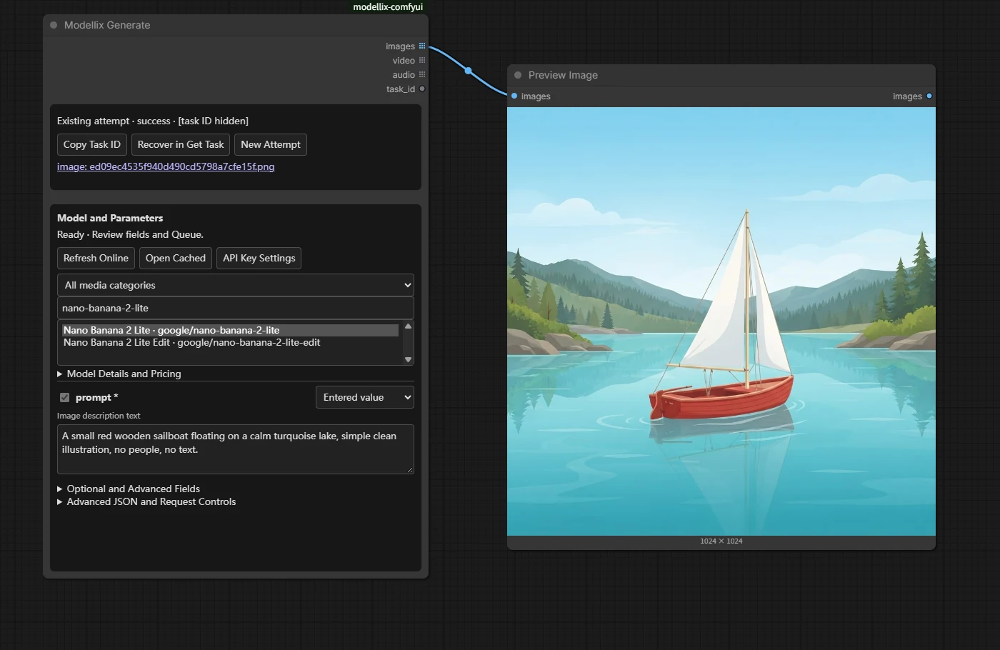
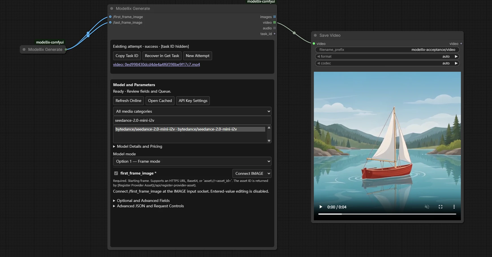
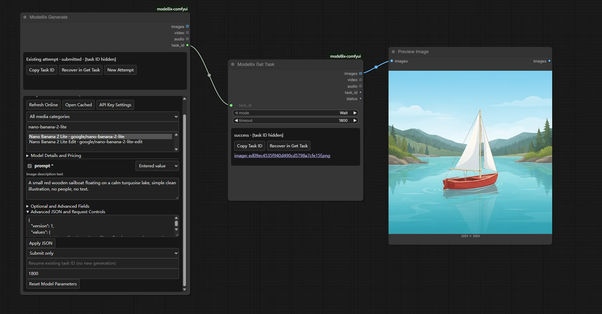
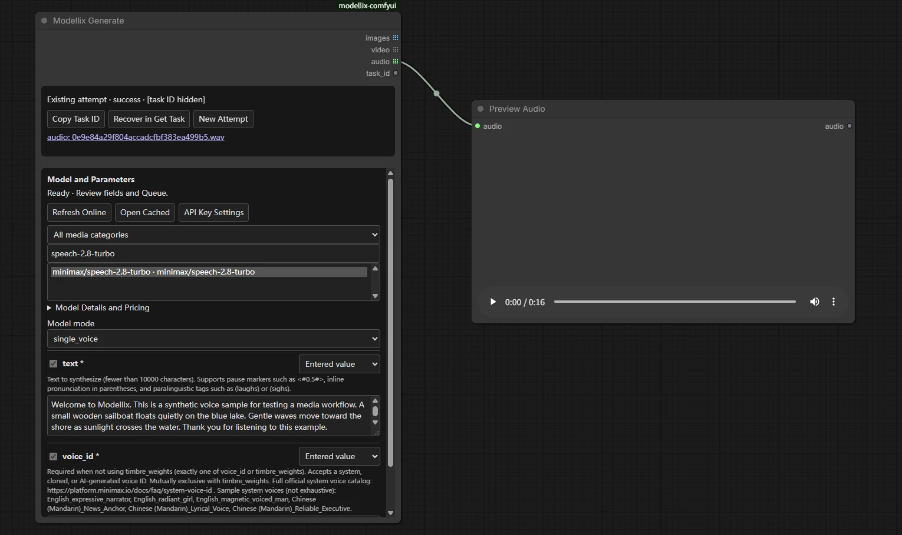
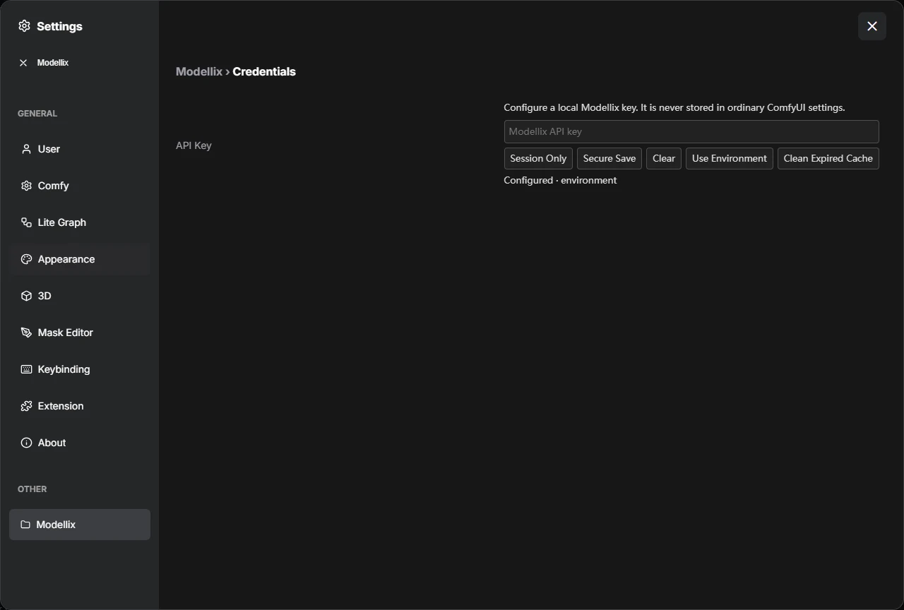

# modellix-comfyui

Official [Modellix](https://www.modellix.ai) media nodes for ComfyUI. One schema-driven **Modellix Generate** node covers image, video and speech generation and transformations. Native media connections upload automatically; results connect to ComfyUI preview/save nodes.

[Full tutorial](https://docs.modellix.ai/ways-to-use/comfyui) · [Examples](examples) · [Support and acceptance matrix](examples/support-matrix.md)

## Workflow tour

These screenshots show real workflows in the tested local ComfyUI host. API keys are never displayed, and task identifiers are concealed. The image and video examples follow the same small sailboat through generation and animation; the speech example uses a synthetic voice.

### Generate and preview an image

Choose a live model, enter a prompt in its generated form, and connect the native IMAGE output to Preview Image. Wait for the selected model's form to finish loading before Queue; a loading or failed selection cannot submit the previous model.



### Connect image references to video

Use the first/last-frame branch and connect each IMAGE field independently. The returned VIDEO connects directly to native Save Video.



### Retrieve an existing task

Submit only returns the task ID. Get Task reads that same task and returns native media, without another generation or upload.



### Generate native audio

Choose a speech model and connect its AUDIO output to Preview Audio. Model fields preserve their actual types and sample-rate options.



### Configure a local key

The password control offers session use, OS secure storage, clearing, and environment fallback. Its status shows the source, never the key.



To reproduce these paths, import the matching [UI workflows](examples/workflows) from the Template Browser or drag their JSON onto the canvas. Review the model fields and mute unused output nodes before Queue. For another paid result, explicitly choose **New Attempt**.

## Install

Requires ComfyUI **0.40.0+**, Python **3.10+**, a funded [Modellix API key](https://www.modellix.ai/console/api-key), and the Python dependencies below. The initial host baseline is ComfyUI v0.40.0 / frontend 1.55.17. Use a local, single-user host at `http://localhost:8188/`.

At startup, the package checks the host's reported ComfyUI version before importing its nodes or registering routes. Versions below 0.40.0, including pre-releases of 0.40.0, are rejected with a message showing the requirement and detected version. Missing or invalid version metadata also blocks registration with upgrade/repair guidance. Update ComfyUI and restart before using the nodes.

### Registry and Manager

[Comfy Registry](https://registry.comfy.org/publishers/modellix/nodes/modellix-comfyui) version **0.1.0** is available from publisher **Modellix** (`modellix`). In ComfyUI-Manager, search for `modellix-comfyui`, choose version **0.1.0**, install, and restart ComfyUI. Refresh the Manager catalog/version list if the new release is not yet visible.

With Comfy CLI configured for your ComfyUI installation:

```sh
comfy node install modellix-comfyui@0.1.0
```

### Git installation

From your ComfyUI directory:

```sh
git clone https://github.com/Modellix/modellix-comfyui.git custom_nodes/modellix-comfyui
python -m pip install -r custom_nodes/modellix-comfyui/requirements.txt
```

Use the interpreter that runs ComfyUI. Windows portable, from its portable root:

```powershell
.\python_embeded\python.exe -m pip install -r .\ComfyUI\custom_nodes\modellix-comfyui\requirements.txt
```

Restart ComfyUI, then search for **Modellix** under **Modellix / Media**. No local model weights, CLI, Node service, Partner Nodes account or third-party video nodes are required. Import never installs dependencies or calls the network.

For Registry installs, choose the desired published version in Manager and restart. For Git installs, pull this repository, install requirements and restart. Published Registry versions are immutable; changes pushed to GitHub main reach Registry users through a new version release.

## Configure a key

Open **Settings → Modellix → API Key**. Enter the key in the password field and choose **Session Only** or **Secure Save**. Secure Save uses an available OS keyring (Windows Credential Manager, macOS Keychain or Linux Secret Service/KWallet). A locked/missing backend produces an error; there is no plaintext fallback. Status displays only configuration/source.

Priority: session → secure storage → `MODELLIX_API_KEY`. Key changes apply immediately to new executions; an active task keeps its starting credential context. Clear deletes the session/saved key and suppresses environment fallback for the current process until **Use Environment** is explicitly selected. Storage deletion failures are reported.

Credential changes clear the previous account's visible catalog, pricing, and schema fields. A cleared key cannot reopen that catalog, including through a late in-flight response; configure a key before loading models again.

For headless use, set `MODELLIX_API_KEY` before starting ComfyUI. Never put a key in node inputs, workflows, PNG metadata, screenshots or issue reports. Local configuration routes require loopback, same origin, JSON and a session CSRF nonce. This credential setup is for single-user local hosts, not a public multi-user service.

## Use the nodes

| Node | Behavior | Outputs |
| --- | --- | --- |
| **Modellix Generate** | Live catalog/schema form, automatic uploads, one submission, Wait or Submit only | IMAGE list, VIDEO list, AUDIO list, task ID |
| **Modellix Get Task** | Wait or one Snapshot of an existing task; every Queue refreshes | Same media/task outputs + status |
| **Modellix Upload Media** | Upload IMAGE/VIDEO/AUDIO in the selected group order | URL list as STRING outputs, custom URL List object, file IDs and media types |
| **Modellix URL List** | Merge existing lists and one HTTPS URL per line; append/prepend, preserve duplicates/order | `MODELLIX_URL_LIST` |

Generate, Get Task and Upload Media are output nodes: Queue can execute them even without a Preview connection. **Mute** unused output nodes or use partial execution. Disconnecting Preview does not disable generation.

1. Add Generate and choose a category/model by name or slug.
2. Fill the model's required fields. Alternative schema branches have explicit selectors.
3. For a media field, enter a URL or select a typed connection. For image edits, connect Load Image; for first/last frames, use separate IMAGE sockets. Arrays preserve input-list and tensor-batch order.
4. Keep **Wait**, connect the appropriate output to Preview Image, Save Video or Preview Audio, then Queue.

The authenticated catalog retains the real model `type`. It includes text-to-image, image-to-image, text-to-video, image-to-video, video-to-video, text-to-speech and speech-to-speech. Speech-to-text returns text and is outside the media output contract. Models with unavailable schemas show an actionable error. Slugs, including dots, are never guessed from filenames.

Every bound field is declared through native V3 typed Autogrow sockets and validated again against its active schema. One field accepts one source; entering JSON/URL values and binding the same field is an error. Scalar fields reject multiple list items instead of taking the first. Optional unset values differ from null, false, zero and empty strings. The advanced JSON editor supports complex values; normal workflows use form controls.

When a saved schema changes, refreshing shows the affected fields and removes incompatible draft values/bindings. Queue stays blocked until you check the new form and click **Accept Reviewed Schema**. Refresh, credential changes, reopening the workflow, and New Attempt do not accept that change. Acceptance saves the reviewed hash; it does not queue work or change the attempt nonce.

Media outputs contain real native objects: RGB `[1,H,W,3]` float tensors, `VideoFromFile`, and AUDIO `{waveform: [B,C,T], sample_rate}`. Separate resources remain separate list entries, preserving different dimensions/rates. Inapplicable media outputs use an ExecutionBlocker; there are no dummy images or empty audio/video objects.

## Submit, cancel and recover

**Wait** submits once, polls using bounded server waits, downloads and converts results. **Submit only** returns the task ID with no queries/downloads and blocked media outputs. Connect task ID to Get Task or paste an ID into its input. Snapshot returns pending/processing without media; queue again to refresh. Get Task and Generate's `resume_task_id` never create a generation or upload.

**New Attempt** changes the saved `run_nonce`. The next Queue may create one paid request. A normal Queue, a mode/timeout change, cache cleanup or process restart reuses the existing attempt/task. Copies have distinct `node_instance_id` values. Parameter/media changes also identify a different request, so review edits before queueing.

New Attempt also clears an existing `resume_task_id` and the previous task display, so recovery mode cannot silently override the new request. Reviewing an updated schema alone retains the same paid attempt; it does not replay an unknown submission. The local timeout includes model discovery, schema loading, and waiting for shared local work.

Generation and upload POST requests are not retried automatically, including 429/500/503, timeouts, broken connections and missing/invalid task IDs. A persistent attempt is written before submission. If a response is lost or the process stops while submitting, the outcome stays unknown and automatic replay is blocked. Inspect Console history; do not assume the request was free or unaccepted.

ComfyUI Cancel stops local network waits and downloads. It cannot promise remote cancellation or a refund. A known task ID remains recoverable after cancellation, timeout, decoding or download failure. The same key context must own the task. A terminal upstream failure is reported without creating another task.

Get Task status and its copy/recovery actions follow the current execution's ID, including errors and local deadlines. A 404 identifies the requested task or model. Parameter errors preserve cleaned upstream field guidance while omitting credentials, signed URLs, and echoed request values; paid POST requests still never replay automatically.

## Uploads and URL lists

Native inputs are encoded as PNG/MP4/WAV using host libraries. REST upload defaults to **200 MiB per file**, with server/model limits and team file quotas still applying. Uploads are serial; identical successful content can be reused while valid. Missing expiry is conservatively capped at 24 hours. No remote files are deleted automatically.

Use Upload Media for reusable URLs or advanced mixed references. Its list outputs align by index. Connect `url_list` to a Generate array field; a scalar URL can use `urls` only if exactly one URL is produced. URL List preserves commas inside URLs and duplicate references; blank lines are dropped. Field array minimum/maximum constraints still apply.

## State and cache

Host paths are obtained from ComfyUI, independent of the working directory:

- State: `<user_directory>/modellix/state.sqlite3`, SQLite WAL and atomic attempt records.
- Results: `<output_directory>/modellix/`, randomly generated local filenames.
- Partial downloads are cleaned on failure/cancel and installed atomically.

Records contain task/model IDs, timestamps, fingerprints and local file indexes, not keys, prompts, request bodies or input media. Result eviction never deletes attempt/unknown-submission protection. Damaged attempt records/database fail closed instead of enabling a paid replay. Catalogs are isolated by credential context; public schemas are shared.

If a completed download cannot be decoded, recovery fetches a fresh copy from the original task instead of repeatedly accepting the bad cached bytes. Local result links also work with a configured `MODELLIX_RESULT_DIRECTORY`; the result route cannot serve the private state database.

Defaults: catalog TTL 10 minutes, schema TTL 1 hour, result TTL 7 days, cache 10 GiB, resource download 2 GiB, task download 4 GiB, image 64 MP. Files returned to the host remain pinned conservatively until process exit. Restart to release those pins before reclaiming expired results. Corrupt/missing local results are re-downloaded from the original task; expiry never automatically authorizes a new generation.

Advanced environment configuration: `MODELLIX_STATE_DIRECTORY`, `MODELLIX_RESULT_DIRECTORY`, `MODELLIX_CACHE_BYTES`, `MODELLIX_RESOURCE_BYTES`. Do not expose the private state directory through static hosting. Downloads use credential-free sessions, public HTTPS validation, bounded redirects/retries, chunked limits and free-disk checks. API/schema origins are fixed; schemas cannot redirect your key to another host.

## Errors

- **400**: review schema types, required fields, branch and descriptive constraints.
- **401**: configure the correct key. **402**: check Console billing/balance.
- **404**: unavailable schema/model/task; refresh or choose another available model.
- **413**: input too large. **429**: inspect request/file quota; do not blindly requeue paid work.
- **Unknown outcome**: inspect history before explicitly choosing New Attempt.
- **Timeout/download/decode error**: resume the existing task ID.
- **Disk/cache limit**: clean unused expired results or adjust limits; active files stay pinned.

## Examples and API prompts

[examples](examples) contains importable UI workflows and equivalent API prompts. [example_workflows](example_workflows) is generated from the same source for ComfyUI Template Browser. Workflows contain no key or real task IDs. See the examples README for inputs and which nodes incur charges.

The wire format is version 1. `parameters_json` is `{"version":1,"values":{...},"branches":{...}}`; legacy plain parameter objects remain readable. Branch keys are JSON Pointer paths followed by `/oneOf` or `/anyOf`. `bindings_json` is `{"version":1,"bindings":[{"socket":"images.slot0","pointer":"/image"}]}`. API prompts connect the declared socket name, for example `"images.slot0": ["load-image-id",0]`. Supply stable `node_instance_id` and `run_nonce`. The schema hash protects saved workflows from unreviewed schema changes. GET-only recovery may omit model/schema information.

## Development and verification

Frontend regression tests use Node.js 24.

```powershell
python -m venv .venv
.\.venv\Scripts\python -m pip install -e ".[dev]"
.\.venv\Scripts\python -m ruff check .
.\.venv\Scripts\python -m pytest tests/unit -q
node --test tests/web/schema-form.test.mjs
python tools/package.py
```

Pure Python CI runs on Windows/Linux and Python 3.10/3.12 without pretending ComfyUI is installed. Real host tests use the actual CPU ComfyUI interpreter and native codecs, separately. Live billed acceptance is explicitly enabled and keeps durable task records so rerunning acceptance can resume paid work. See [support-matrix.md](examples/support-matrix.md) for actual versions, coverage, platform limitations and known external schema exclusions. A package/wheel build alone does not prove host installation or generation.

MIT licensed. Public schema fixtures are snapshots from Modellix's public schema endpoint; controlled protocol fixtures use fake credentials and task IDs.
